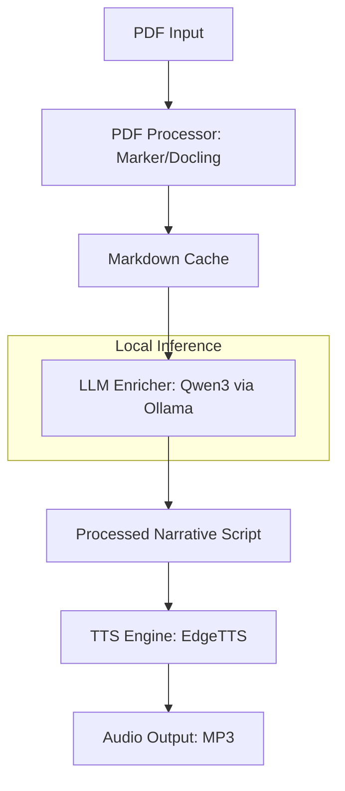

# Design: PDF to Audiobook (Local Qwen3)

## Architecture Overview

O sistema segue uma arquitetura linear de processamento em 4 etapas principais, coordenadas por um módulo central CLI.

## Component Details

### 1. PDF Processor (`pdf_processor.py`)
- **Lib**: `marker-pdf` (preferida pela conversão para Markdown).
- **Responsabilidade**: Converter PDF para Markdown, agrupando parágrafos e identificando seções.
- **Cache**: Armazena o `.md` gerado para evitar re-processamento pesado de PDF.

### 2. LLM Enricher (`context_engine.py`)
- **Model**: Qwen3 (via Ollama API).
- **Strategy**: 
    - Divide o Markdown em chunks respeitando o contexto do modelo.
    - System Prompt: Atuar como um roteirista de audiolivro, limpando "lixo" visual e OCR, e mantendo o tom narrativo.
    - Saída: Texto limpo, contínuo e narrativo.

### 3. Audio Generator (`audio_generator.py`)
- **Lib**: `edge-tts`.
- **Flow**:
    - Recebe o texto processado.
    - Seleciona voz (ex: `pt-BR-AntonioNeural` ou `pt-BR-FranciscaNeural`).
    - Salva o streaming em chunks para gerir arquivos grandes.

### 4. CLI Orchestrator (`main.py`)
- **Entry point**: Comando `pdf-audio [input_path] [options]`.
- Módulo de gerenciamento de estado (para onde parou o processamento).

## Data Flow

1. O usuário aponta um PDF.
2. O sistema verifica se o `uv` e `ollama` estão funcionais.
3. Conversão para Markdown.
4. O LLM lê o Markdown e gera um script de narração concatenado.
5. O TTS gera o áudio final.

## Security & Reliability

- **Secrets**: Não há chaves de API pagas (Ollama é local, EdgeTTS é gratuito/web).
- **Error Handling**: Se o Ollama falhar, o sistema oferece continuar usando o texto bruto do PDF.
- **Resource Management**: Uso de streams para evitar carregar o livro inteiro na memória (RAM).

## Tech Stack

- **Linguagem**: Python 3.9+
- **Gestão**: `uv`, `pyproject.toml`
- **Lint/Type**: `ruff`, `mypy`
- **Inference**: `ollama` (API REST)
- **TTS**: `edge-tts`
