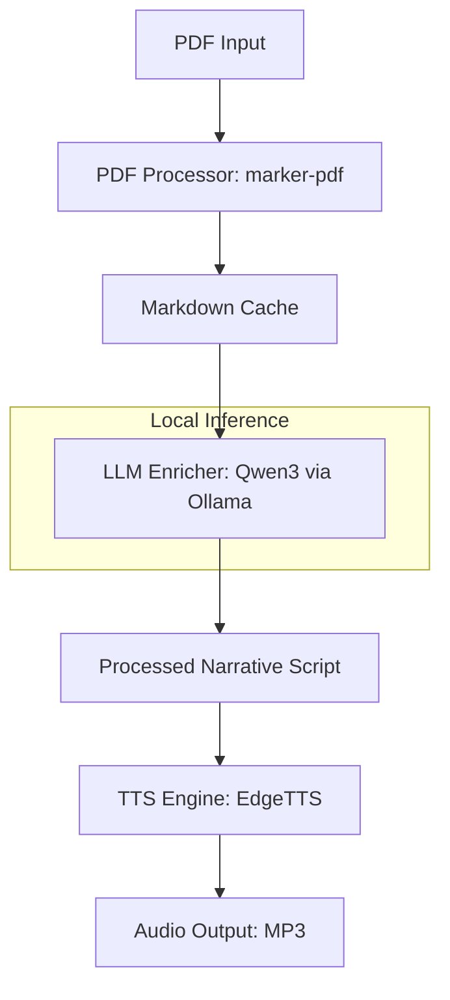

# Arquitetura Técnica (Technical Architecture)

Este documento descreve a estrutura interna e o fluxo de dados do **PDF to Audiobook CLI**. O sistema foi projetado para ser modular, resiliente e focado em privacidade (execução local).

## Visão Geral do Sistema

O processamento segue um fluxo linear de 4 estágios principais:

## Componentes Principais

### 1. PDF Processor (`src/pdf_processor.py`)
- **Tecnologia**: `marker-pdf`.
- **Função**: Converte arquivos PDF brutos em Markdown estruturado.
- **Diferencial**: Identifica cabeçalhos e rodapés para facilitar a limpeza posterior pelo LLM. Mantém um cache em `.md` para evitar re-processamento em caso de falha nos estágios seguintes.

### 2. LLM Enricher (`src/context_engine.py`)
- **Modelo**: `qwen3` rodando localmente via **Ollama**.
- **Função**: Atua como um "editor literário". Ele remove ruídos de OCR, números de página e adapta o texto para uma leitura natural (ex: silenciando referências bibliográficas extensas).
- **Processamento**: O texto é dividido em blocos (chunks) com sobreposição para manter a coerência narrativa.

### 3. Audio Generator (`src/audio_generator.py`)
- **Tecnologia**: `edge-tts`.
- **Função**: Transforma o script final em áudio MP3 utilizando vozes neurais de alta qualidade.
- **Streaming**: O áudio é gerado em tempo real, permitindo lidar com livros de centenas de páginas sem estourar a memória.

### 4. CLI Orchestrator (`src/main.py`)
- **Framework**: `click`.
- **Função**: Interface de linha de comando que coordena os três módulos acima. Gerencia os argumentos do usuário, o progresso visível (via `rich`) e o tratamento de erros global.

## Fluxo de Dados

1. **Entrada**: O usuário fornece o caminho de um PDF.
2. **Normalização**: O PDF vira Markdown.
3. **Refinamento**: O LLM limpa o Markdown seguindo um `System Prompt` otimizado para Audiobooks.
4. **Síntese**: O texto refinado é enviado para o motor de TTS.
5. **Saída**: O arquivo `.mp3` é salvo na pasta `outputs/`.

## Decisões de Design

- **Privacidade Local**: O núcleo do processamento (IA de texto) roda 100% offline via Ollama.
- **Eficiência**: Uso extensivo de `asyncio` para comunicação com o Ollama e geração de áudio.
- **Confiabilidade**: Logs detalhados e barras de progresso informam o usuário exatamente em que fase o processo se encontra.
